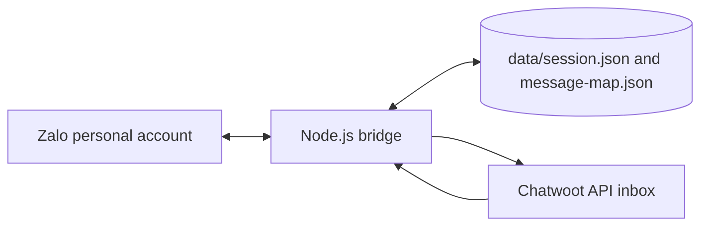

# Chatwoot Zalo Personal Bridge

Unofficial TypeScript bridge between a Zalo personal account and a Chatwoot API inbox.

This project is for operators who need to receive Zalo personal messages in Chatwoot and reply from Chatwoot back to Zalo. It handles plain text, media forwarding, reply mapping, selected Zalo system messages, template message forwarding from Chatwoot, and optional group mention markers.

## Important Disclaimer

This is an unofficial integration using an unofficial Zalo Personal API. Account/session stability, API compatibility, and platform policy compliance are not guaranteed. Use at your own risk, test with a non-critical account first, and be ready to re-login or disable the bridge if Zalo changes behavior.

## What It Does

- Creates or reuses Chatwoot contacts/conversations for Zalo peers.
- Sends incoming Zalo messages/media to a Chatwoot API inbox.
- Uploads Zalo GIF messages as animated `image/gif` attachments instead of raw SDK JSON.
- Recovers PDF, GIF, JPEG, PNG, and WebP extensions when Zalo supplies a missing or generic filename.
- Forwards public outgoing Chatwoot messages and templates to Zalo.
- Skips private notes and bridge-originated Chatwoot messages to avoid loops.
- Stores message mappings in `data/message-map.json` so replies can become native Zalo quotes.
- Mirrors Zalo message recalls to the exact mapped Chatwoot message.
- Supports optional `[[zalo:alias]]` markers for group mentions.

## Limitations

- Zalo Personal is not an official stable API surface.
- QR login and cookie/session persistence can expire without warning.
- Media forwarding depends on URLs that both services can fetch.
- Recall synchronization requires the target message to exist in the current durable message map. Unknown targets are logged and ignored.
- Group mention IDs must be maintained by the operator.
- This bridge is source-only; build output and runtime data are intentionally not committed.

## Architecture



## Quick Start

```bash
git clone https://github.com/39elbarto/chatwoot-zalo-personal-bridge.git
cd chatwoot-zalo-personal-bridge
npm ci
cp .env.example .env
$EDITOR .env
npm run build
npm run login:qr
npm start
```

In Chatwoot, create an API inbox and configure its webhook URL:

```text
https://bridge.example.com/webhooks/chatwoot
```

`/callback` is also accepted as a shorter compatibility path.

## Environment Variables

| Variable | Required | Purpose |
| --- | --- | --- |
| `PORT` | no | HTTP port, default `4001`. |
| `CHATWOOT_BASE_URL` | yes | Chatwoot base URL, for example `https://chatwoot.example.com`. |
| `CHATWOOT_API_TOKEN` | yes | Chatwoot user access token with inbox/conversation permissions. |
| `CHATWOOT_ACCOUNT_ID` | yes | Numeric Chatwoot account ID. |
| `CHATWOOT_INBOX_ID` | yes | Numeric API inbox ID. |
| `CHATWOOT_INBOX_IDENTIFIER` | yes | API inbox identifier/source token from Chatwoot. |
| `CHATWOOT_INSTANCE_KEY` | no | Namespace for contact custom attributes. |
| `CHATWOOT_CONTACT_IDENTIFIER_PREFIX` | no | Prefix for Chatwoot contact identifiers, default `zalo:`. |
| `CHATWOOT_CONTACT_IDENTIFIER_LEGACY_PREFIXES` | no | Comma-separated old prefixes to search before creating contacts. |
| `CHATWOOT_SOURCE_ID_PREFIX` | no | Prefix for Chatwoot conversation source IDs. |
| `ZALO_IMEI` | yes | Stable device identifier used by the Zalo library. |
| `ZALO_USER_AGENT` | yes | Browser user agent used for login/session restoration. |
| `ZALO_LANGUAGE` | no | Zalo language, default `vi`. |
| `ZALO_COOKIE_JSON` | yes | Zalo cookies as JSON. `npm run login:qr` can populate it. |
| `ZALO_SESSION_FILE` | no | Session context path, default `./data/session.json`. |
| `ZALO_MENTIONS_CONFIG_FILE` | no | Optional mention config path. |

## Chatwoot Setup

1. Create an API inbox in Chatwoot.
2. Copy the inbox ID and inbox identifier into `.env`.
3. Create or reuse a Chatwoot user access token for the bridge.
4. Add a webhook pointing to `/webhooks/chatwoot`.
5. Enable message-created events only if your Chatwoot version lets you filter events.

The bridge forwards public outgoing messages and public template messages. Private notes and messages marked with `additional_attributes.source = zalo_native` are ignored.

## Zalo Login

Run:

```bash
npm run login:qr
```

Scan `data/qr.png` from the Zalo mobile app when prompted. The script updates `.env` and `data/session.json`. Both files are sensitive and ignored by git.

## Operations

Use [docs/RUNBOOK.md](docs/RUNBOOK.md) for install, login, restart, verification, rollback/abort, and log checks.

## Dependency License Posture

The project is MIT licensed. Runtime dependencies are npm packages and should be reviewed with your organization's policy before production use. At publication time, the direct runtime dependency licenses are MIT, BSD-2-Clause, and Apache-2.0:

```bash
npm view @warriorteam/zalo-personal license
npm view axios dotenv express form-data jsqr pngjs qrcode-terminal license
```

The key legal risk is not package license compatibility; it is the unofficial Zalo Personal API posture described above.
